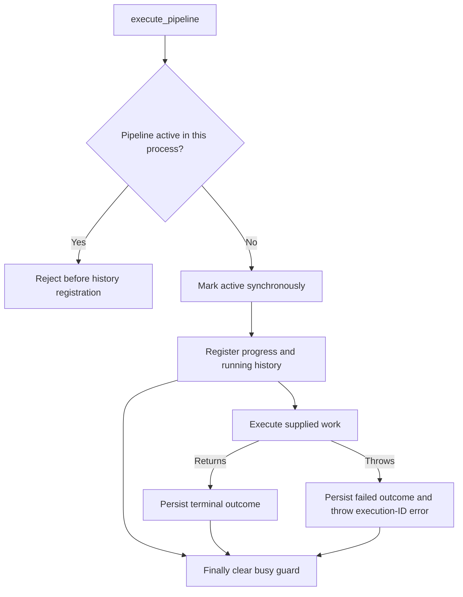
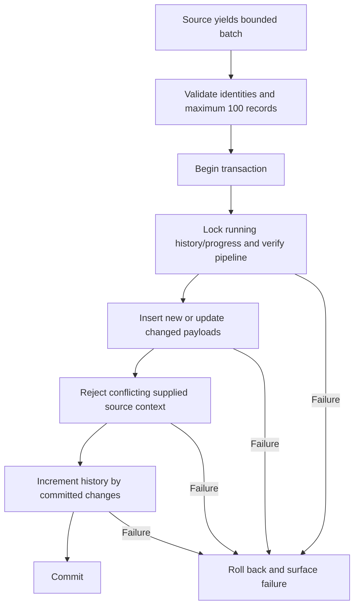
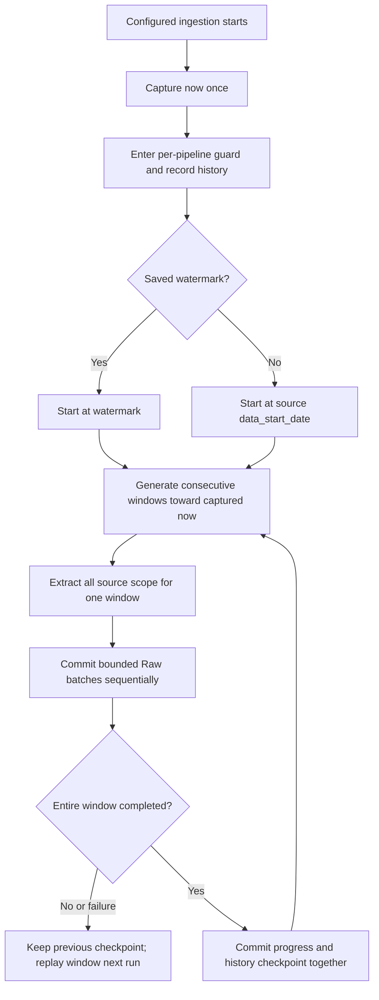

# Current data flows

See [architecture](architecture.md) for module/schema ownership, [setup and commands](setup-and-commands.md) for effects and evidence, and [next steps](../plan/next-steps.md) for remaining implementation.

## 1. Source reads

The business-date pilot reader reads one page without warehouse access. The modification-time extractor follows all validated pages for a requested restaurant/window, yielding bounded nonempty batches. [The read-only window check](../sandbox/check-toast-order-window.ts) uses an explicit one-day range and a two-minute overall deadline; this deadline is a check budget, not a default historical-ingestion duration.

Toast requests use 20-second timeouts plus caller cancellation. Order responses are capped at 4 MiB; discovery at 1 MiB. The streamed [response reader](../core/toast/toast-response.ts) handles split UTF-8, cancels oversized bodies and redacts JSON parse errors. Authentication does not yet use that byte cap.

Safe page/count diagnostics do not log tokens or order payloads. Reading one restaurant/window proves neither all-restaurant coverage nor report freshness.

## 2. Execution lifecycle and busy protection



[The orchestrator](../core/system/pipeline-orchestrator.ts) handles supplied work and outcome persistence, not source discovery or checkpoint calculation. `finally` clears the busy flag on every exit, including history-start/completion failures. Different pipeline names remain independent.

One worker/process is the operating assumption. Do not run standalone ingestion while that worker is active; stop the old process before replacement. The guard is not cross-process locking and does not recover abandoned history.

Completion preserves previously committed counts/checkpoints when omitted from the outcome. Original work exception details are currently replaced with a generic safe summary and execution-ID error. If required history persistence fails, that error surfaces and history may remain `running`.

## 3. Raw batch transaction



Remote reads occur outside database transactions. [The loader](../core/system/raw-pipeline-loader.ts) commits Raw changes and counts together; it does not advance source coverage.

| Input | Raw effect | History count |
| --- | --- | --- |
| New source identity | Insert revision 1, pending processing | +1 |
| Changed payload with matching/omitted context | Preserve ID/creation, update payload/revision, clear processed | +1 |
| Equal payload with matching/omitted context | No update | +0 |
| Conflicting supplied context, including stored NULL | Reject entire transaction | No committed change |
| Empty batch | Verify running execution, no Raw insert | +0 |
| Invalid/duplicate identity, excessive batch, wrong/finished execution | Reject | No committed change |

Omitted context preserves attribution; supplying context does not silently correct old NULL context. Deliberate provenance corrections require their own approval. Raw row locks last only for the batch transaction.

The user reported successful synthetic warehouse checks for changed-payload revisions, unchanged replay, context-conflict rollback and an actual PostgreSQL history-count overflow rolling back a Raw insert. Concurrent context conflicts and source-version ordering are not covered by that evidence.

## 4. Resumable ingestion

**There is one normal ingestion flow, not separate historical and incremental systems.**



[The shared executer](../core/system/ingestion-executer.ts) defaults to 24-hour elapsed-time windows; pipelines may override `ingestion_window_hours`. The final window ends at captured now. Explicit-date checks/replays use the same extractor/loader/window code without reading or advancing normal progress.

[Toast's configuration](../core/toast/toast-configuration.ts) starts at January 1, 2026, midnight UTC when no watermark exists. This is the user-selected starting boundary, not proof that older data is unavailable. [Configured Toast ingestion](../core/toast/toast-ingestion.ts) discovers restaurants once and consumes every restaurant's pages in each window. Empty, invalid or duplicate restaurant discovery fails rather than claiming coverage.

After the extractor finishes, [window completion](../core/system/pipeline-progress.ts) runs a separate short transaction:

1. Lock and verify the running execution and associated pipeline progress.
2. Require the previous watermark to match expected state.
3. Advance progress to the window end, update successful-ingestion/update timestamps, and record the same watermark in history.
4. Commit both updates, or roll back both on failure.

The source calls and Raw batches are not held inside this checkpoint transaction. Checkpoint failure cannot make the code skip an unfinished boundary; replay may repeat already committed Raw changes safely when payloads/context are unchanged.

### Failure and restart boundaries

- A later page/restaurant failure leaves earlier committed batches but does not checkpoint the incomplete window.
- Earlier fully completed windows remain checkpointed even if the overall run subsequently fails.
- A crash after the last batch but before checkpointing replays the window. A committed checkpoint allows resuming at the next boundary.
- Cancellation is checked around windows/batches/loads. In-flight database queries are not immediately cancelled; committed work is not undone. Thrown cancellation currently records `failed`, not `cancelled`.
- Successful-ingestion time is the time of the last checkpointed window, not proof the complete run or downstream processing succeeded.
- A changing source is not a snapshot. Late arrivals, source-version correctness and correction/lookback policy remain unresolved.
- Newly discovered restaurants do not automatically get earlier historical coverage once shared progress has advanced; deliberate historical replay is needed for that scope change.

Offline synthetic tests exercise these control-flow boundaries and checkpoint transaction logic. Actual connected checkpoint persistence and process-interruption recovery have not yet been verified. The existing user-run Toast window ingestion used explicit dates and deliberately left progress unchanged.

## 5. Processing and publication: still planned

```text
durable Raw -> revision-safe Processed -> business-oriented Refined -> published freshness
```

No concrete downstream tables/mappers/reports are implemented. Remaining guarantees include:

- Commit Processed output and acknowledgment of the exact Raw revision together.
- Keep newer Raw revisions pending when older work finishes.
- Support mapping-version replay without re-fetching unchanged Raw records.
- Reconcile money, refunds, voids and split checks to trusted source reports.
- Publish report freshness only after required transformations complete.

No scheduler or supervised worker is connected. See the [development plan](../plan/project-plan.md) rather than treating these as current guarantees.
