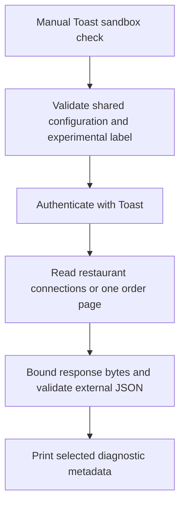
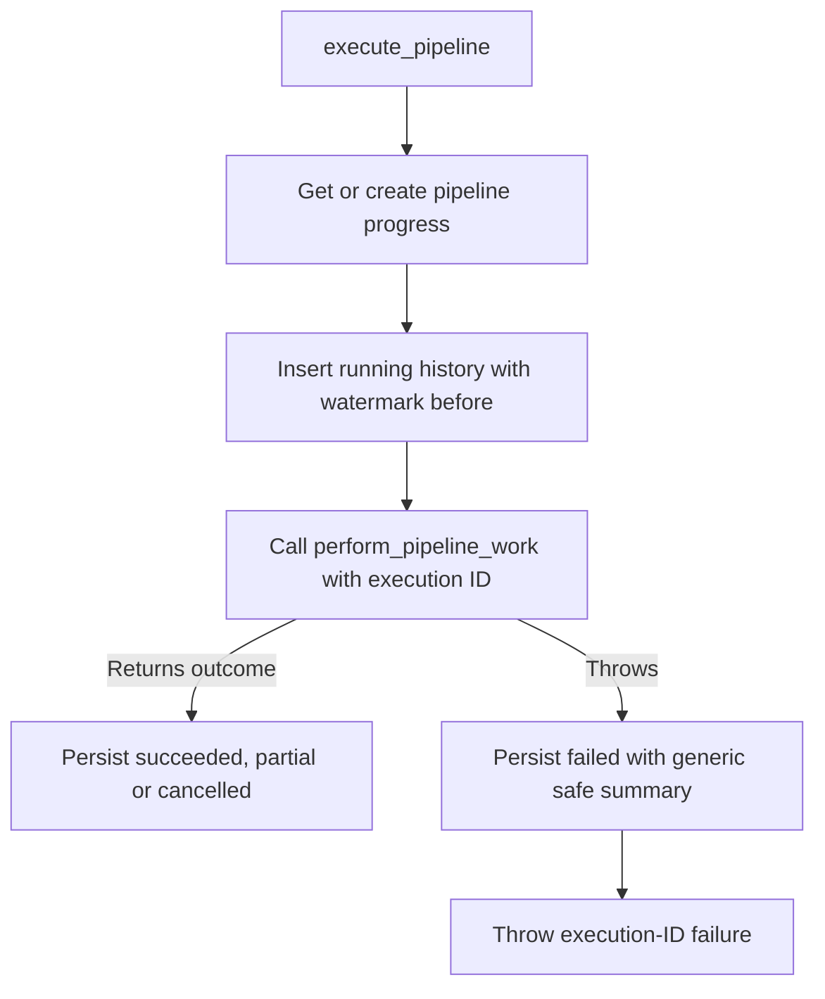
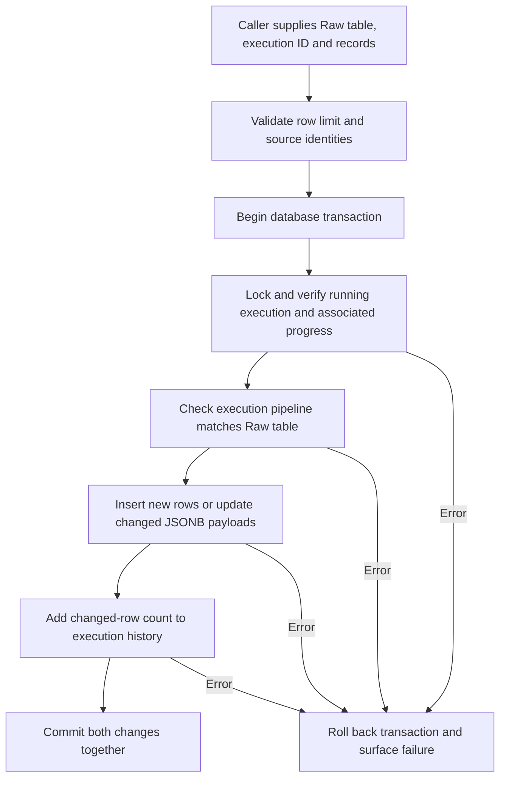

# Current data flows

Read [architecture](architecture.md) for schemas and [next steps](../plan/next-steps.md) for the work needed to connect these flows.

## 1. Read-only Toast checks



There is **no warehouse write or progress update** in this flow. Restaurant discovery prints accessible restaurant identifiers/names and a count; order checking prints a count, pagination-header presence and first-order field names. Neither prints tokens or order/customer payload values.

The order check uses the pilot restaurant/business date configured in [check-toast-orders.ts](../sandbox/check-toast-orders.ts). It reads page 1 only. Ten returned orders or a pagination header does not establish complete source coverage.

## 2. Execution lifecycle



[The orchestrator](../core/system/pipeline-orchestrator.ts) executes only the supplied callback. It does not discover pipelines, fetch source records, load Raw, calculate a watermark or process records automatically.

[History completion](../core/system/pipeline-history.ts) permits one transition from running to a terminal status. Optional metadata can be supplied by callers; omission does not reset previously committed counts.

### Failure boundaries

- A callback failure does not undo earlier committed batch transactions.
- The failed attempt retains its previously committed counts when completion omits them.
- The orchestrator records a generic redacted summary and throws an error containing the execution ID; detailed original-cause diagnostics are not currently preserved by it.
- If required history persistence fails, that error surfaces. A durable terminal status is not guaranteed and the attempt can remain running.
- There is no automatic recovery of running attempts after process interruption, and no whole-execution overlap lock.

The [orchestrator sandbox check](../sandbox/check-pipeline-orchestrator.ts) simulates a committed count by updating history directly before throwing. It does not prove Raw transaction behavior.

## 3. Raw batch transaction

This flow exists in [load_raw_records](../core/system/raw-pipeline-loader.ts), but no current sandbox invokes it with Toast records.



Remote reads belong **outside** this transaction. The transaction contains database work only.

### Inserts, changes and replay

| Input | Raw effect | History count effect |
| --- | --- | --- |
| New complete source identity | Create row, revision 1, pending processing | +1 |
| Existing identity with different JSONB | Preserve ID/creation time; replace content; increment revision; reset processed; update execution/time | +1 |
| Existing identity with equal JSONB | Preserve all Raw fields, including execution/update metadata | +0 |
| Empty batch | Verify execution, no Raw insert | +0 |
| Invalid identity, duplicate identity, more than 100 records, missing/finished/wrong-pipeline execution | Reject; no committed Raw changes | No committed increment |

If a database operation fails within the transaction, Raw changes and its count increment roll back together. This is the implementation boundary; an experimental integration check must still prove it.

The loader does **not** update `pipeline_progress`, mark a source window complete, compare source modification versions, or coordinate deletions. Per-batch locks are released at transaction end and are not an execution-wide exclusion mechanism.

For the next replay check, reuse the same in-memory page. A second live fetch may return genuinely changed data and cannot prove zero-change replay.

## 4. Boundaries not yet connected

The future flow is:

```text
Complete bounded source window -> durable Raw -> revision-safe Processed
                              -> business-oriented Refined -> published freshness
```

It is a target, not implemented behavior:

- Complete windows need bounded pagination and coverage of every participating restaurant.
- A checkpoint must never advance ahead of durable data. A page-only test leaves it unchanged.
- Processing must write output and acknowledge the exact Raw revision in one transaction.
- A newer Raw revision arriving during processing must remain pending, not be acknowledged by stale work.
- Mapping-version replay must work even when Raw content has not changed.
- Reports become current only after their required transformations/publication succeed, not when extraction starts or history is marked succeeded.

These are tracked in the [development plan](../plan/project-plan.md), rather than presented as existing guarantees.
