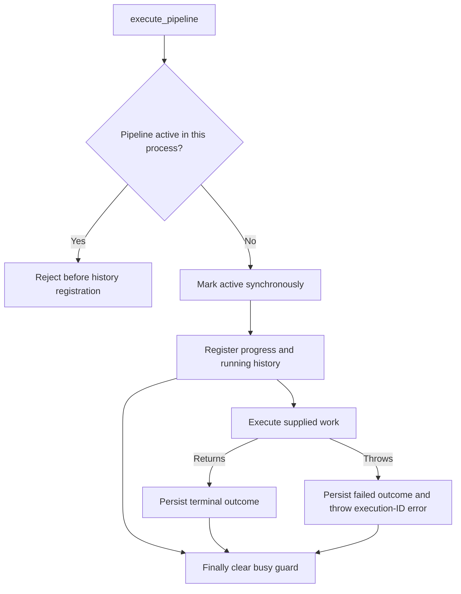
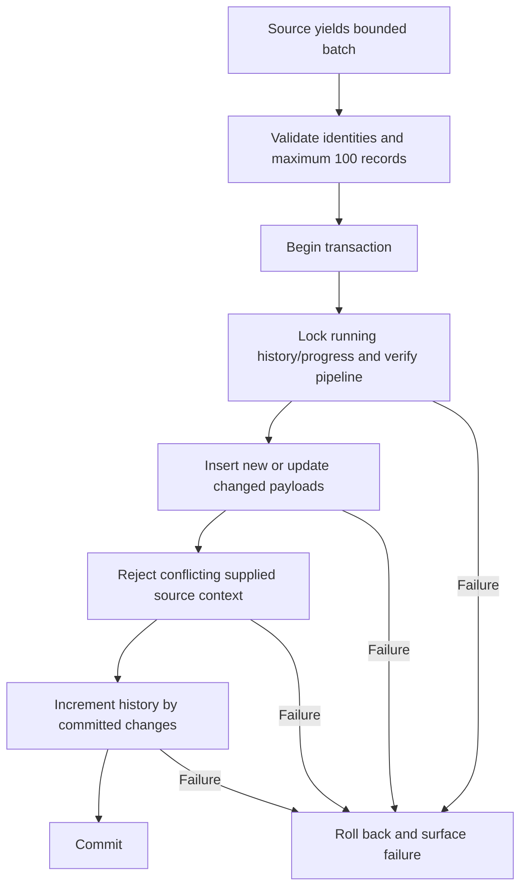
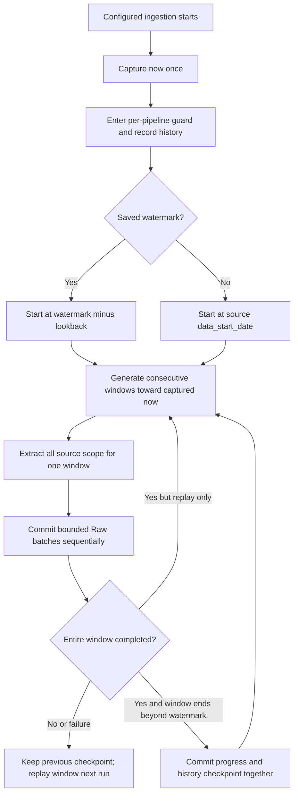
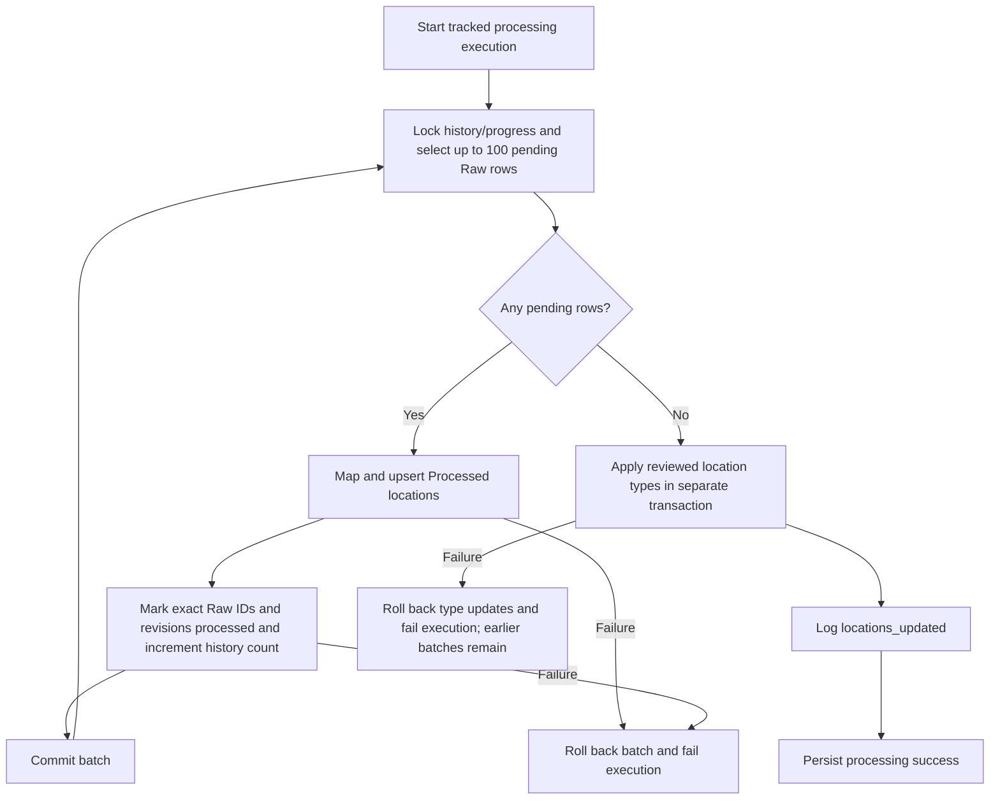

# Current data flows

See [architecture](architecture.md) for module/schema ownership, [setup and commands](setup-and-commands.md) for effects and evidence, and [next steps](../plan/next-steps.md) for remaining implementation.

## 1. Source reads

The business-date pilot reader reads one page without warehouse access. The modification-time extractor follows all validated pages for a requested restaurant/window, yielding bounded nonempty batches. [The read-only window check](../sandbox/check-toast-order-window.ts) uses an explicit one-day range and a two-minute overall deadline; this deadline is a check budget, not a default historical-ingestion duration.

Toast requests use 20-second timeouts plus caller cancellation. Responses are capped at 4 MiB for orders, 1 MiB for discovery, and 64 KiB for authentication. The streamed [response reader](../core/toast/toast-response.ts) handles split UTF-8 and cancels oversized bodies. The [request helper](../core/toast/toast-request.ts) spaces orders requests five seconds apart across locations in one process and logs bounded retries without exposing request data. The [authentication helper](../core/toast/toast-authentication.ts) reuses the access token.

Safe page/count diagnostics do not log tokens or order payloads. Reading one restaurant/window proves neither all-restaurant coverage nor report freshness.

## 2. Execution lifecycle and busy protection



[The orchestrator](../core/system/pipeline-orchestrator.ts) handles supplied work and outcome persistence, not source discovery or checkpoint calculation. `finally` clears the busy flag on every exit, including history-start/completion failures. Different pipeline names remain independent.

One worker/process is the operating assumption. Do not run standalone ingestion while that worker is active; stop the old process before replacement. The guard is not cross-process locking and does not recover abandoned history.

Completion preserves previously committed counts/checkpoints when omitted from the outcome. The orchestrator returns the execution ID and persisted status, or throws on a failure; logs for an execution carry its `execution_id`. History stores a safe summary of thrown work errors, while the exception retains the original cause without automatically logging it. If required history persistence fails, that error surfaces and history may remain `running`.

## 3. Raw batch transaction



Remote reads occur outside database transactions. [The loader](../core/system/raw-pipeline-loader.ts) commits Raw changes and counts together; it does not advance source coverage.

| Input | Raw effect | History count |
| --- | --- | --- |
| New source identity | Insert revision 1, pending processing | +1 |
| Changed payload with matching/omitted context | Preserve ID/creation, update payload/revision, clear processed | +1 |
| Equal payload with matching/omitted context | No update | +0 |
| Conflicting supplied context, including stored NULL | Reject entire transaction | No committed change |
| Empty batch | Verify running execution, no Raw insert | +0 |
| Invalid/duplicate identity, excessive batch, wrong/finished execution | Reject | No committed change |

Omitted context preserves attribution; supplying context does not silently correct old NULL context. Deliberate provenance corrections require their own approval. Raw row locks last only for the batch transaction.

The user reported successful synthetic warehouse checks for changed-payload revisions, unchanged replay, context-conflict rollback and an actual PostgreSQL history-count overflow rolling back a Raw insert. Concurrent context conflicts and source-version ordering are not covered by that evidence.

## 4. Resumable ingestion

**There is one normal ingestion flow, not separate historical and incremental systems.**



[The shared executer](../core/system/ingestion-executer.ts) defaults to seven elapsed days per window and a one-day lookback for configured runs with a saved watermark. Toast orders overrides the window size to 28 days, not the lookback. The last window ends at captured now and can be shorter. Explicit-date checks/replays reuse extraction and loading without using or advancing the normal watermark.

[Toast orders](../core/toast/toast-orders.ts) starts at June 1, 2026, midnight UTC when no watermark exists. This is a chosen boundary, not proof of available history. It discovers locations once per run when extraction is needed, then consumes each location's pages (up to 100 orders per page) in every window. Invalid, empty or duplicate location discovery fails rather than claiming coverage. Order windows use source modification time, not the date the order was placed.

After the extractor finishes, [window completion](../core/system/pipeline-progress.ts) runs a separate short transaction:

1. Lock and verify the running execution and associated pipeline progress.
2. Require the previous watermark to match expected state.
3. Advance progress to the window end, update successful-ingestion/update timestamps, and record the same watermark in history.
4. Commit both updates, or roll back both on failure.

The source calls and Raw batches are not held inside this checkpoint transaction. Checkpoint failure cannot make the code skip an unfinished boundary; replay may repeat already committed Raw changes safely when payloads/context are unchanged.

### Failure and restart boundaries

- A later page/restaurant failure leaves earlier committed batches but does not checkpoint the incomplete window.
- Earlier fully completed windows remain checkpointed even if the overall run subsequently fails.
- A crash after the last batch but before checkpointing leaves that window unacknowledged. The next configured run starts at the last durable boundary minus the lookback, so it may replay some already committed work.
- Cancellation is checked around windows/batches/loads. In-flight database queries are not immediately cancelled; committed work is not undone. Thrown cancellation currently records `failed`, not `cancelled`.
- Successful-ingestion time is the time of the last checkpointed window, not proof the complete run or downstream processing succeeded.
- A changing source is not a snapshot. The current overlap mitigates some late arrivals; it does not guarantee coverage of late or older corrections or prevent all out-of-order versions.
- Newly discovered restaurants do not automatically get earlier historical coverage once shared progress has advanced; deliberate historical replay is needed for that scope change.

Offline synthetic tests exercise these boundaries and checkpoint transaction logic. User-run configured loads reported successful Raw changes, but a controlled connected interruption/fresh-process restart and full coverage audit remain unverified. An isolated [synthetic restart check](../sandbox/check-ingestion-restart.ts) exists for the former.

## 5. Location snapshots and manual sync

[Raw locations](../core/toast/toast-locations.ts) refreshes the current accessible catalog in batches of at most 100. It does not advance a time watermark or infer deletion from a missing location. A new-GUID warning reports discovery, not successful persistence or an orders backfill. [Manual Toast sync](../core/toast/toast-sync.ts) completes and checks the location outcome before starting Raw orders; independently, orders still discovers locations directly from Toast.

## 6. Processed locations and type mapping



`npm run process -- toast-locations` invokes [the shared executer](../core/system/processing-executer.ts), not Toast extraction. It drains all pending rows, checks cancellation between batches, and rejects invalid callback counts. Each [location batch](../core/toast/toast-locations.ts) locks history/progress before Raw; output, exact revision markers and the count commit together. The mapper validates names and deletion flags and preserves lineage. Mapping failures fail the batch rather than silently dropping a record.

The upsert does not overwrite `type`. Finalization applies the reviewed [GUID-to-type map](../core/toast/toast-location-type-map.ts), even when the first batch returns zero. It locks each mapped Processed row, skips unchanged types, and updates only `type`/`updated_at`. A missing mapped row or failed update rolls back the complete type-application transaction. New unmapped locations retain the default `unclassified`; existing unmapped types are preserved.

`processing_batch_completed` records positive Raw batch counts. `location_types_applied` records changed classifications separately as `locations_updated`. Both use the processing execution's logger. A rerun without Raw or mapping changes has zero Raw work and zero classification changes. A mapping edit can change classifications without modifying Raw or the ingestion watermark.

Finalization is inside the tracked execution and process-local guard, not a follow-up after success. It must finish before success is recorded. Cancellation cannot undo committed batches or an already committed type transaction; thrown cancellation currently records failure. No helper updates `last_successful_processing_at` yet.

## 7. Deletion handling: implemented helper, unfinished ingestion wiring

The intended end-to-end path is:

```text
source confirms deletion -> Raw.deleted = true and pending -> Processed.deleted = true
```

Only the following pieces are currently implemented:

- `mark_raw_records_deleted` in [the Raw loader](../core/system/raw-pipeline-loader.ts) marks confirmed, existing active Raw IDs deleted in batches of at most 100. It requires the correct running execution, preserves payload/identity, increments revisions and sets `processed = false`. Raw changes and history `records_loaded` increment commit together; repeat/unknown IDs contribute zero changes.
- The location mapper carries `raw.deleted OR content.deleted` into Processed, with output and exact Raw acknowledgment in the same transaction.
- `Raw_Record_Input` declares optional `deleted` metadata, but ordinary loading ignores it.

There is **no automatic caller of the deletion helper**, no source-missing comparison, no normal-ingestion restoration, and no Processed orders implementation. Deletion-only input metadata currently does not trigger an upsert. If Raw is marked deleted now, an ordinary later upsert does not clear that flag.

Source deletion is different from a void or refund. An ID missing from incremental/date-filtered results is not proof of deletion. Automatic missing-record deletion must wait for a complete, authoritative inventory of the same scope and a successfully finished scan. Unchanged rows do not receive a new execution ID on ordinary replay, so the existing Raw `execution_id` cannot serve as a last-seen marker.

Analytics must deliberately exclude deleted data; there is no current report/view enforcing that filter. Propagation to Processed requires successful processing and is not immediately guaranteed when processing is failing. [Next steps](../plan/next-steps.md) describes the small remaining implementation stages.

## 8. Publication boundary

```text
durable Raw -> revision-safe Processed -> business-oriented Refined -> published freshness
```

Locations processing is implemented and user-reported on the experimental database. Remaining work includes:

- Verify actual PostgreSQL lock/revision concurrency and rollback boundaries beyond the synthetic tests and simple user-reported executions.
- Support mapping-version replay without re-fetching unchanged Raw records.
- Reconcile money, refunds, voids and split checks to trusted source reports.
- Publish report freshness only after required transformations complete.

No scheduler or supervised worker is connected. See the [development plan](../plan/project-plan.md) rather than treating these as current guarantees.
